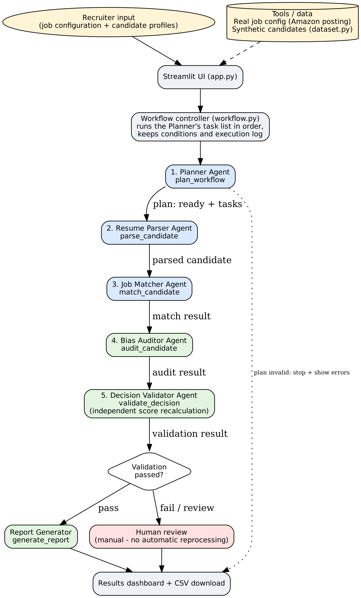
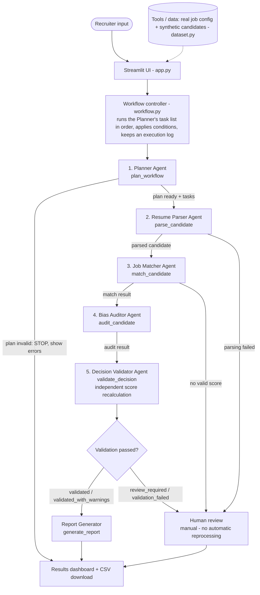

# RecruitAI — Multi-Agent Recruitment Screening and Validation System

> **Data notice.** The job requirements come from a **real, official Amazon posting** (Data Engineer I, Job ID 2829886).
> All candidates are **synthetic (fictional)**. The scoring weights are **this project's own prototype design**, not Amazon's
> hiring criteria. The system **supports** a human recruiter; it never hires, rejects or shortlists anyone.

## 1. Project overview
RecruitAI coordinates five specialised workflow agents and one report generator. They process candidate information,
compare it with the configured job requirements, check selected fairness risks, **independently validate** the result and
produce a report for a human recruiter.

| Part | Owner | Files |
|---|---|---|
| Planner, Resume Parser, Job Matcher, schemas, dataset, job research | User 1 | `agents.py`, `schemas.py`, `dataset.py`, `job_research.md`, `tests/test_agents.py` |
| Bias Auditor, Decision Validator, Report Generator | User 2 | `agents_part2.py` |
| Workflow controller, Streamlit UI, UI tables | User 2 | `workflow.py`, `app.py`, `view_tables.py` |
| Integration and validation tests | User 2 | `tests/test_workflow.py`, `tests/test_part2_agents.py` |

`agents_part2.py` is a separate file only so that the two team members never edit each other's files. No file owned by User 1 was changed.

## 2. Problem statement
Organizations receive many resumes. Reading each one, comparing it with the job, spotting missing skills and keeping the
evaluation consistent is slow and varies between reviewers.

## 3. Domain justification
HR / recruitment screening is repetitive, rule-driven and high-volume, which suits structured agents. It is also a sensitive
domain (fairness, privacy), so the design keeps a **human in charge**, makes every score explainable, and adds an independent
validation step.

**Manual screening vs. assisted screening**

| | Manual | RecruitAI (assisted) |
|---|---|---|
| Consistency | Varies by reviewer | Same configured rules for every candidate |
| Explanation | Often implicit | Every score lists each criterion and its points |
| Missing data | Easily mistaken for "lacks the skill" | Reported as *missing information* and sent to review |
| Checking the result | Rarely re-checked | Score recalculated independently; failures go to a human |
| Final decision | Human | **Still the human** |

*Time savings are not claimed: they were not measured.*

## 4. Real job data source
Amazon (Amazon.com Services LLC), **Data Engineer I**, Job ID 2829886 —
<https://amazon.jobs/en/jobs/2829886/data-engineer-i> (accessed 2026-10-14, recorded by User 1 in `job_research.md`).
Both team members should open the link and save a PDF/screenshot before the viva (the posting may be removed once filled).

* **Required (from the posting):** SQL, ETL, Data Modeling, Data Warehousing, Scripting Language (examples given: Python, KornShell).
* **Preferred (reported, never scored):** Hadoop, Hive, Spark, EMR, ETL Tool (Informatica, ODI, SSIS, BODI, DataStage).
* **Experience:** 1+ years (reported, not scored). **Education:** none stated.
* **Prototype weights (our design):** SQL 25, ETL 20, Data Modeling 15, Data Warehousing 15, Scripting Language 15, relevant_project 10 = 100.

## 5. Synthetic candidate data strategy
Eight fictional candidates in `dataset.py`, each designed to exercise one situation: all criteria matched (C001), one required
skill missing (C002, C003), no relevant project (C004), preferred "big-data" skills but missing required ones (C005),
**incomplete information** (C006), limited experience (C007), and an equivalent-skill case (C008). No real people, contact
details, age, gender, religion, caste, photo or marital status.

## 6. Architecture




**How one agent's output becomes the next agent's input**

| From → To | Structured data passed |
|---|---|
| Recruiter/UI → Planner | `job` dict, `candidates` list |
| Planner → controller | plan: `status`, ordered `tasks`, `errors`, `warnings` (if not `ready`, the workflow stops) |
| Parser → Matcher | parsed candidate: normalized skills, `missing_fields`, `invalid_fields`, `parsing_status` |
| Matcher → Auditor / Validator | match result: `criterion_scores`, `match_score`, matched/missing skills, `explanation` |
| Auditor → Validator | audit result: `audit_status`, `checks`, `warnings`, `review_issues` |
| Validator → Report Generator | validation result: `validation_status`, `errors`, `warnings`, `recalculated_score`, `human_review_required` |
| All → Dashboard | one record per candidate + `summary` + `execution_log` + `report` |

## 7. Agent responsibilities
These are **specialised workflow agents implemented as deterministic Python functions**. There is no LLM and no autonomous reasoning.

| # | Agent | Function | What it does |
|---|---|---|---|
| 1 | Planner | `plan_workflow(job, candidates)` | Validates job + candidates, returns an ordered task list or `invalid_input` |
| 2 | Resume Parser | `parse_candidate(candidate)` | Cleans a structured record, normalizes skills, lists missing/invalid fields |
| 3 | Job Matcher | `match_candidate(parsed, job)` | Scores each configured criterion; explains every point |
| 4 | Bias Auditor | `audit_candidate(match, parsed, job)` | Read-only fairness-related checks (below) |
| 5 | Decision Validator | `validate_decision(audit, match, parsed, job)` | Independently verifies; decides report vs human review |
| — | Report Generator | `generate_report(results)` | Builds the recruiter report and CSV rows |
| — | Workflow controller | `run_workflow(job, candidates)` | Calls all of the above in order with real `if` branches |

### Bias Auditor — what it checks (and what it cannot claim)
1. **Scoring criteria:** every configured criterion must be a required skill of the job or `relevant_project` (documented allowlist); sensitive criteria (age, gender, religion, caste, marital status, photo …) are flagged.
2. **Consistent evaluation:** the result must contain exactly the configured criteria, each worth 0 or its full weight.
3. **Missing information:** separates *demonstrated* / *not demonstrated* / *unknown (missing information)*; missing data is never treated as "lacks the skill".
4. **Sensitive information:** sensitive fields in the input are ignored by the parser; the controller scans the raw record and the auditor reports them as a warning.
5. **Explanation:** a short plain-language summary.

Audit status meanings: `passed` (the implemented checks found nothing — **not** a fairness guarantee), `warning` (non-critical), `review_required` (serious, a human must look), `error` (the audit could not run). The auditor never changes the score.

## 8. Technology stack
Python 3, Streamlit (UI), Pandas (tables + CSV), pytest (tests), Graphviz/Mermaid (diagram). No paid API, no API key, no database, no LLM, no cloud.

## 9. Installation
```bash
python -m venv .venv
source .venv/bin/activate            # Windows: .venv\Scripts\activate
pip install -r requirements.txt
```

## 10. How to run the application
Run from the project folder (the modules import each other by name):
```bash
streamlit run app.py
```
Optional console demo of User 1's agents: `python agents.py`.

## 11. How to run the tests
```bash
python -m pytest -q
```
Expected: **no failures**. With Streamlit installed you should see 73 passed (24 from User 1 + 49 from User 2); without Streamlit the one Streamlit end-to-end test is skipped (72 passed, 1 skipped).

| Required test area | Test |
|---|---|
| 1 Complete successful workflow | `test_01_…` |
| 2 Invalid job configuration | `test_02_…` |
| 3 Empty candidate list | `test_03_…` |
| 4 Candidate with missing information | `test_04_…` |
| 5 Missing required skill | `test_05_…` |
| 6 Duplicate / inconsistent IDs | `test_06a/b/c_…` |
| 7 Deliberately altered score | `test_07_…`, `test_07b_…`, `test_controlled_injection_…` |
| 8 Invalid score > 100 | `test_08_…` |
| 9 Invalid weights | `test_09_…` |
| 10 Bias Auditor warning | `test_10_…`, `test_10b_…` |
| 11 Failure → human review | `test_11_…` |
| 12 Success → normal report | `test_12_…` |
| 13 One failed candidate ≠ crash | `test_13a/b/c_…` |
| 14 Report with multiple candidates | `test_14_…`, `test_14b_…` |
| 15 CSV consistent columns | `test_15_…` |
| 16 Names do not affect scores | `test_16_…` |
| 17 UI uses the integrated workflow | `test_17a/b_…` (tables), `test_17c_…` (Streamlit `AppTest`) |

## 12. Expected demonstration (about 3 minutes of the 5)
1. `streamlit run app.py`. Show **Section 1** (real Amazon job, clickable source, weights) and open the *architecture* expander.
2. **Section 2:** click *Load synthetic sample dataset*.
3. **Section 3:** click **Run Recruitment Screening**. Open the five agent expanders; point to the execution log.
4. **Section 4 KPIs** should read: Total 8, Validated 7, Requiring review 1, Validation failures 0.
5. **Section 5:** inspect **C006** (incomplete record → *review_required*, not rejected) and **C007** (*validated_with_warnings*: experience below the posting's 1+ years, reported only).
6. **Validator demo (clearly a test):** in the sidebar tick *Inject a tampered Matcher score*, choose C002, score 99, run again. A red banner states test mode; C002 becomes **validation_failed** ("Matcher reported 99 but the independent recalculation gives 75") and KPIs change to review 2 / failures 1.
7. **Section 7:** download the CSV and open it.

## 13. Validation behavior
| Situation | Result |
|---|---|
| Invalid job / empty candidate list | Workflow **stops**, shows the planner's errors, no report |
| Parsing failed (no ID / not a dict) | Not matched, audited or validated; **human review** |
| Matching failed / no score | Not treated as valid; **human review** |
| Duplicate candidate IDs | Flagged; **human review** |
| Missing required information | `review_required` — never an automatic rejection |
| Serious audit finding | `review_required` |
| Audit warning only (e.g. sensitive input field ignored, experience below posting minimum) | `validated_with_warnings`; warning shown |
| ID mismatch, score outside 0–100, score ≠ recalculated score (tolerance 0.01), invalid weights, unexpected criterion, missing audit | **`validation_failed`** → human review |
| Everything consistent | `validated` → normal report |
| An agent raises an exception for one candidate | Error recorded for that candidate; the batch continues; `workflow_status = completed_with_errors` |

These are validation outcomes, **not hiring decisions**. A low score never makes a candidate "unqualified". There is **no automatic reprocessing**: failed items go to a human.

## 14. Results (measured)
*Normal demonstration (8 synthetic candidates, real job configuration):* 8 processed; **7 validated** (6 `validated`, 1 `validated_with_warnings`); **1 requires human review** (C006, incomplete record); **0 validation failures**. Independent recalculation equals the Matcher's score for all 8.

*Controlled tests (deliberately injected errors, not normal results):* altering each of the 8 scores once → **8 of 8 discrepancies detected**; out-of-range scores (150, 100.5, −1, "80", None, True, NaN), wrong IDs and bad weights are all rejected. The validator's independent scoring code agreed with the Matcher on all 8 samples **and 300 random candidates (0 disagreements)**.

*Test run (build environment, real pytest 9.1.1):* **72 passed, 1 skipped.** The skipped test is the Streamlit end-to-end test (`test_17c_…`), because Streamlit could not be installed in that environment (package downloads were blocked). To check that the tests are meaningful, three faults were deliberately introduced into a scratch copy and each made tests fail: (1) the validator's score comparison disabled, (2) the audit outcome ignored, (3) an invalid plan no longer stopping the workflow. **Run `python -m pytest -q` on your own machine and use that output in the viva** — with Streamlit installed you should see 73 passed. The Streamlit page itself was executed there only against a stub (no errors, correct KPI values), not in a real browser — launch `streamlit run app.py` once yourself before presenting.

*Unverified:* any claim about time saved or hiring quality — not measured, not claimed.

## 15. Limitations and future scope
**Limitations:** (1) synthetic data does not represent real candidates; (2) keyword matching misses equivalent wording (e.g. "ELT", "dimensional modelling") and has no notion of skill depth; (3) weights are prototype choices, not employer criteria; (4) fairness checks are limited and cannot prove absence of discrimination; (5) the system makes no hiring decisions; (6) human review remains necessary; (7) the validator re-implements the scoring rule, so if the rule itself is wrong both would be wrong — it catches inconsistency, not a wrong rule; (8) PDF/DOCX resume parsing is not implemented.

**Future scope:** PDF/DOCX resume parsing, semantic skill matching, local LLM integration, stronger fairness evaluation, recruitment-system integration, audit logging.

## Files
```
RecruitAI/
├─ app.py              Streamlit UI (User 2)
├─ workflow.py         workflow controller (User 2)
├─ agents_part2.py     Bias Auditor, Decision Validator, Report Generator (User 2)
├─ view_tables.py      Pandas tables for the UI, no Streamlit import (User 2)
├─ agents.py           Planner, Parser, Matcher (User 1)
├─ schemas.py  dataset.py  job_research.md   (User 1)
├─ requirements.txt  README.md
├─ docs/               architecture diagram, presentation draft, viva guide, rubric checklist
└─ tests/              test_agents.py (User 1), test_workflow.py, test_part2_agents.py (User 2)
```


## Uploading a different candidate dataset

The Streamlit UI supports **structured CSV uploads** in addition to the built-in synthetic sample. In Section 2, expand **Upload your own candidate dataset (CSV)**, download the template if needed, choose a CSV, preview the parsed candidates, and click **Use uploaded candidates**. The uploaded records then go through the same Planner, Parser, Matcher, Bias Auditor, Validator, and Report Generator workflow.

Required CSV headers: `candidate_id`, `name`, `skills`, `experience_years`. Optional headers: `education`, `projects`, `certifications`. Separate multiple skills/projects/certifications with semicolons (`;`) or pipes (`|`). Extra columns are ignored. Candidate IDs must be unique; at most 500 candidates are accepted per upload. Invalid experience text is retained so the workflow can flag it for review. The app provides a downloadable template. **This feature accepts structured CSV, not PDF/DOCX resumes**; it does not extract candidate data from free-form resume files. Use fictional/test data for classroom demonstrations and ensure you have permission to process any real personal data.
